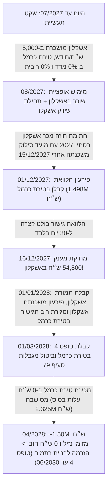

# דוח החלטה אסטרטגי ופיננסי: אשקלון, טירת הכרמל ומגרש רתמים (`02_decision_report.md`)

**תאריך חתך לניתוח:** דצמבר 2026 | **אופק השוואה אחיד:** ספטמבר 2029 (`09/2029`, 33 חודשים — מועד סיום חלון 18 החודשים מטופס 4 בטירת הכרמל וערב הישורת האחרונה לבניית רתמים)  
**קבצי מקור ומודל:** [01_facts_ledger.md](file:///home/antigravity/01_facts_ledger.md) | [scenarios_model.py](file:///home/antigravity/scenarios_model.py)

---

## 1. שורה תחתונה וביקורת קרה על הנחות היסוד שלך

לפני שנצלול למספרים, הנה **האמת המקצועית החדה** לגבי ההנחות שאיתן נכנסת למהלך — איפה צדקת לחלוטין ואיפה השוק והאינטואיציה הובילו אותך למלכודות שעולות עשרות אלפי שקלים:

### א. איפה צדקת במאה אחוז: שעון מס השבח על אשקלון (`החלטת מיסוי 8838/21`)
האינטואיציה שלך לגבי מס השבח על אשקלון הייתה **מדויקת לחלוטין**:
- מכיוון שדירה "על הנייר" בטירת הכרמל אינה נחשבת `"דירת מגורים"` לפי סעיף 1 לחוק מיסוי מקרקעין עד לסיום בנייתה (קבלת טופס 4), **שעון 18 החודשים למכירת אשקלון בפטור ממס שבח כמשפר דיור (סעיף 49ג(1)) כלל לא התחיל לרוץ בחתימת החוזה (`30/08/2024`), אלא יתחיל לרוץ רק ביום קבלת טופס 4 בטירת הכרמל (`01/03/2028`)**.
- יתרה מכך, רשות המסים עיגנה זאת מפורשות ב**החלטת מיסוי 8838/21** ובהוראת ביצוע **5/2013**, ומשרד האוצר אף פרסם ב-2025 תזכיר חוק המאשרר שזהו המצב המשפטי הנוהג: ניתן למכור את הדירה הישנה (אשקלון) בפטור ממס שבח **גם בתקופת הביניים שלפני טופס 4 של הדירה החדשה**, או לחלופין בתוך 18 חודשים לאחר טופס 4 (לעניין מס שבח) ובתוך **12 חודשים ממסירת החזקה בפועל** (לעניין מס רכישה — סעיף 9(ג1ג)(2)(ב)).
- **המשמעות הכספית:** הפטור ממס שבח על אשקלון (חיסכון של **`~223,500 ש"ח`** מס על שבח של כמיליון ש"ח!) **שמור ובטוח ב-100%** בין אם תמכור את אשקלון ב-`01/2028` (לפני טופס 4) ובין אם תמכור אותה עד `01/03/2029` (12 חודשים ממסירת טירת הכרמל).

---

### ב. איפה אתה טועה ומפסיד כסף ("אשליות השוק" שצריך לחתוך עכשיו)

1. **אשליית "חובת ההמתנה של 18 חודשים" בטירת הכרמל (התובנה שמשנה את כל התמונה):**
   - התוכנית שלך להחזיק את טירת הכרמל 18 חודשים אחרי טופס 4 (`03/2028` עד `09/2029`) נשענת על ההנחה שאם תמכור אותה מיד עם קבלת טופס 4 תשלם 25% מס שבח.
   - **המציאות החשבונאית-מיסויית:** מס שבח (25%) משולם **אך ורק על השבח הריאלי** (מחיר המכירה בניכוי מחיר הרכישה **הצמוד למדד המחירים לצרכן** מיום כל תשלום, ובניכוי הוצאות רכישה ומכירה מוכרות לפי סעיף 39 לחוק: עו"ד קבלן, מס רכישה, עו"ד מכירה ותיווך).
   - מכיוון שנהנית מפטור ממדד תשומות הבנייה אבל לצורכי מס שבח העלות שלך מוצמדת למדד המחירים לצרכן (כ-2.5% בשנה), ב-`03/2028` **עלות הבסיס המיסויית שלך בטירת הכרמל תהיה `2,325,090 ש"ח`!**
   - **מסקנה:** בכל מחיר מכירה של טירת הכרמל עד **`2,325,000 ש"ח`**, השבח הריאלי הוא **אפס או שלילי**, ולכן **מס השבח במכירה מיידית ביום קבלת טופס 4 (`03/2028`) הוא `0 ש"ח` עגול!**
   - המתנה של 18 חודשים בטירת הכרמל רק בשביל "לקבל פטור ממס שבח" על עסקה שבה ממילא אין שבח ריאלי היא **שריפת כסף וזמן חינם**: היא שורפת לך **`45,484 ש"ח` נטו** בעלויות מימון/אלטרנטיבה ונועלת לך **`~1.5 מיליון ש"ח`** הון עצמי בדיוק בשנה שבה אתה חייב לבנות את בית המגורים ברתמים (דדליין אכלוס רמ"י: `24/06/2030`).

2. **מלכודת מענק ה-`40,000 ש"ח` באשקלון (`15/12/2027` = צוק של `54,800 ש"ח`):**
   - בדוח יתרות הסילוק של בנק הפועלים (`liabilitiesDetailsPdf.pdf`, עמ' 2, הערה `**`) מופיעה הלוואת מענק מותנה (`8926365127220`) שיתרתה לסילוק היא **`~54,800 ש"ח`**.
   - תאריך סיום ההתחייבות של המענק הוא **`15/12/2027`**.
   - אם תמכור ותסלק את המשכנתה באשקלון לפני `15/12/2027`, תשלם לבנק קנס מיותר של **`54,800 ש"ח`**. אם תחכה ל-**`16/12/2027`**, החוב הזה **נמחק לחלוטין (`0 ש"ח`)** והופך למענק חלוט!

3. **אשליית "גרירת המשכנתה" מאשקלון לטירת הכרמל:**
   - בדקנו את הרכב המשכנתה שלך באשקלון (`748,700 ש"ח` חוב משוער ל-`12/2026` ללא המענק):
     - **69% מהחוב (`514,450 ש"ח`)** נמצא במסלול משתנה לא צמוד בריבית **`4.86%`** (שמתעדכנת ב-`01/2027` לפי עוגן אג"ח + מרווח). זו אינה ריבית מסובסדת אלא ריבית שוק רגילה-גבוהה.
     - **31% מהחוב (`234,250 ש"ח`)** נמצא ב-3 מסלולים צמודי מדד בריבית ממוצעת של **`1.60% + מדד`** (עלות אפקטיבית של `~3.88%` לשנה בהנחת מדד 2.25%, עם יתרת תקופה קצרה עד 2035 שהופכת את ההחזר החודשי לכבד מאוד: `2,469 ש"ח/חודש` על `234K` בלבד).
   - **החיסכון הכלכלי בגרירת המסלולים הצמודים הוא פחות מ-`800 ש"ח` בשנה**, בעוד שמחיר הגרירה הוא הפיכתך ל"לקוח שבוי" של בנק הפועלים בטירת הכרמל, הקפאת כספי המכירה בפיקדון ערבות בנקאית והתמודדות עם שמאות מוקדמת. **עדיף לפרוע את המשכנתה באשקלון במלואה ביום המכירה** ולקחת מימון קצר וגמיש רק על היתרה הקטנה שתזדקק לה.

4. **מוקש סעיף 79 בטירת הכרמל (חסימת הסבת זכויות לפני טופס 4):**
   - סעיף 79 לנספח השינויים (`חוזה מכר מ.אור.pdf`, עמ' 52) קובע שלפני טופס 4 **אסור לך להסב/למכור את הדירה במחיר נמוך ממחירון החברה באותה עת**, ובנוסף נדרש פירעון מלא של 100% מתמורת הדירה לקבלן ואישור הבנק המלווה.
   - לעומת זאת, **סעיף 65 לנספח השינויים (עמ' 52)** קובע כי **מיום קבלת טופס 4 ואילך מתבטלות כל מגבלות ההסבה של סעיף 20.3**! לכן נקודת היציאה הנקייה, החופשית והחוקית מטירת הכרמל היא **מיד עם קבלת טופס 4 (`03/2028`)**.

---

## 2. השוואת 6 החלופות האסטרטגיות על ציר זמן אחיד (`12/2026` עד `09/2029`)

כל החלופות הורצו במודל הפיננסי [scenarios_model.py](file:///home/antigravity/scenarios_model.py) על בסיס אותן הנחות בסיס בדיוק:
- **שווי שוק אשקלון (בסיס):** `2,100,000 ש"ח` (שכירות: `5,000 ש"ח` עד `01/2028`, `5,250 ש"ח` מ-`02/2028`).
- **שווי שוק טירת הכרמל (בסיס):** `2,100,000 ש"ח` (שכירות צפויה לאחר מסירה ב-`03/2028`: `5,000 ש"ח/חודש`).
- **ריבית מימון / עלות אלטרנטיבית להון נזיל:** `4.3%` שנתי | **אינפלציה (מדד):** `2.25%` שנתי.
- **עלויות עסקה במכירה:** `1.25%` (עו"ד + שיווק/תיווך משוקלל) = `26,250 ש"ח` לכל דירה שנמכרת.

### הגדרת החלופות שנבדקו:
- **חלופה `3א` (המלצת האופטימיזציה — "חלון הזהב + יציאה בטופס 4"):**
  החזקת אשקלון בשכירות עד **`16/12/2027`** (מחיקת מענק ה-`54,800 ש"ח`), מכירת אשקלון וסילוק המשכנתה ב-**`01/2028`** (`0 ש"ח` מס שבח), שימוש בעודפי המכירה לסגירת יתרת טירת הכרמל, ו**מכירת טירת הכרמל מיד עם קבלת טופס 4 (`03/2028`)** ב-`0 ש"ח` מס שבח (כי העלות המוצמדת היא `2.325M ש"ח`) ו-`5,644 ש"ח` מס רכישה בלבד. כל ההון העצמי (`~1.50M ש"ח`) נזיל ופנוי ב-`04/2028` לבניית רתמים.
- **חלופה `3ב` ("חלון הזהב באשקלון + השארת טירת הכרמל כנכס מניב"):**
  מכירת אשקלון ב-`01/2028` (לאחר מחיקת המענק), השלמת רכישת טירת הכרמל והחזקתה כנכס מושכר ללא מכירה (חוסך עלויות מכירה של `26,250 ש"ח`, אך משאיר הון נעול בטירת הכרמל ומחייב לקיחת משכנתה מוגדלת לבניית רתמים).
- **חלופה `1ב` (תוכניתך המתוקנת — מכירת אשקלון ב-`01/2028` + החזקת טירת הכרמל 18 חודשים עד `09/2029`):**
  מכירת אשקלון ב-`01/2028` כדי להימנע מכפל משכנתאות, השלמת טירת הכרמל ב-`03/2028`, השכרתה ל-18 חודשים ומכירתה ב-`09/2029`.
- **חלופה `1א` (תוכניתך המקורית — מכירת אשקלון רק ב-`09/2028` אחרי מסירת טירת הכרמל + מכירת טירת הכרמל ב-`09/2029`):**
  נשיאת שתי הדירות במקביל בין `12/2027` ל-`09/2028` (9 חודשי חפיפת חוב כבד), מכירת אשקלון ב-`09/2028` ומכירת טירת הכרמל ב-`09/2029`.
- **חלופה `1ב-מוקדם` (מכירת אשקלון כבר ב-`03/2027` מיד בתום 5 שנים למחיר למשתכן):**
  מכירת אשקלון ב-`03/2027` — גוררת תשלום קנס מענק מותנה של **`54,800 ש"ח`** לבנק הפועלים, והחזקת טירת הכרמל עד `09/2029`.
- **חלופה `2` (השארת אשקלון לטווח ארוך + יציאה מטירת הכרמל ב-`03/2028` תוך ביטול הצהרת משפר דיור):**
  שמירת אשקלון כנכס מניב, מכירת טירת הכרמל בטופס 4 (`03/2028`), ודיווח לרשות המסים על אי-מכירת אשקלון — מה שמחייב השלמת **מס רכישה של 8% כרוכש דירה שנייה** על טירת הכרמל (**`165,556 ש"ח` קרן מס + `~38,797 ש"ח` הפרשי הצמדה וריבית מ-2024 = `204,353 ש"ח`**).

---

### טבלת השוואה מרכזית — תרחיש בסיס (`אשקלון = 2.1M ש"ח` | `טירת הכרמל = 2.1M ש"ח` | `ריבית = 4.3%`)

| דירוג | חלופה | הון עצמי נטו ב-`09/2029` (ש"ח) | פער מול החלופה המנצחת | סך "כסף שרוף" (Deadweight Loss)* | מתוכו: מסים נוספים | מתוכו: ריביות בנקים | מתוכו: קנס מענק (`54.8K`) | שיא חוב ומתי ההון הופך לנזיל לרתמים? |
| :---: | :--- | :---: | :---: | :---: | :---: | :---: | :---: | :--- |
| **1** | **חלופה `3א` (מומלצת): מכירת אשקלון ב-`01/2028` + מכירת טירת כרמל בטופס 4 (`03/2028`)** | **`1,589,509 ₪`** | **— (המנצחת)** | **`95,947 ₪`** | `0 ₪` | `43,447 ₪` | `0 ₪` | גישור קצר לשבועיים ב-`12/2027`; **ב-`04/2028` חוב `0 ₪` ו-`~1.50M ₪` מזומן נזיל לרתמים!** |
| **2** | **חלופה `3ב`: מכירת אשקלון ב-`01/2028` + החזקת טירת כרמל כנכס מניב** | **`1,570,274 ₪`** | `-19,235 ₪` | **`108,078 ₪`** | `0 ₪` | `81,828 ₪` | `0 ₪` | חוב קבוע של `~555K ₪`; **`0 ₪` מזומן נזיל לרתמים** (ההון נעול בטירת כרמל, תידרש משכנתת בנייה יקרה ברתמים) |
| **3** | **חלופה `1ב`: מכירת אשקלון ב-`01/2028` + החזקת טירת כרמל 18 חודשים עד `09/2029`** | **`1,544,024 ₪`** | `-45,485 ₪` | **`134,328 ₪`** | `0 ₪` | `81,828 ₪` | `0 ₪` | חוב `~555K ₪` עד `09/2029`; ההון לרתמים משתחרר **רק בספטמבר 2029** (9 חודשים לפני דדליין רמ"י!) |
| **4** | **חלופה `1א` (המקורית): מכירת אשקלון ב-`09/2028` + מכירת טירת כרמל ב-`09/2029`** | **`1,528,330 ₪`** | `-61,179 ₪` | **`174,344 ₪`** | `0 ₪` | `121,844 ₪` | `0 ₪` | **שיא חוב מסוכן של `2,623,764 ₪`** במשך 6 חודשים (`03–09/2028`), החזר חודשי של `~14,500 ₪/חודש`! |
| **5** | **חלופה `1ב-מוקדם`: מכירת אשקלון ב-`03/2027` + החזקת טירת כרמל עד `09/2029`** | **`1,511,278 ₪`** | `-78,231 ₪` | **`159,334 ₪`** | `0 ₪` | `52,034 ₪` | `54,800 ₪` | שיא חוב נמוך (`739K ₪`), אך שורפת `54,800 ₪` על פירעון מוקדם של המענק לפני `15/12/2027` |
| **6** | **חלופה `2`: השארת אשקלון + מכירת טירת כרמל ב-`03/2028` (ספיגת מס רכישה 8%)** | **`1,319,915 ₪`** | **`-269,594 ₪`** | **`365,816 ₪`** | **`204,353 ₪`** | `108,963 ₪` | `0 ₪` | שיא חוב `2,640,379 ₪`; שורפת `204,353 ₪` במס רכישה רטרואקטיבי + ריבית והצמדה לרשות המסים |

*\*הערה: "כסף שרוף" (Deadweight Loss) כולל את סך הריביות לבנקים, מסים נוספים (מס רכישה 8% / מס שבח), קנס מענק מותנה ועלויות עסקה (עו"ד/תיווך) לאורך 33 החודשים.*

---

## 3. ניתוח תזרים מזומנים ועומס מימוני (איפה נקודות החנק?)

1. **הסכנה התזרימית בחלופה `1א` (המתנה עם מכירת אשקלון לאחרי מסירת טירת הכרמל):**
   - לפי נספח ב' להסכם הלוואת הקבלן (`עמ' 90`), מועד הפירעון של הלוואת הבלון ע"ס **`1,498,000 ש"ח`** הוא **90 יום לפני מועד המסירה החוזי**, כלומר ב-**`01/12/2027`**, ובמסירה (`01/03/2028`) עליך להוסיף עוד **`435,000 ש"ח`** (20% יתרת תמורה + 1% הפרש מע"מ + חיבורים).
   - אם לא תמכור את אשקלון עד ינואר-פברואר 2028, תמצא את עצמך במרץ 2028 עם **שתי משכנתאות במקביל בסך כולל של `2,623,764 ש"ח`** (`~691K` באשקלון + `1,933K` בטירת הכרמל)!
   - מעבר לעובדה שהבנק ידרוש הוכחת הכנסה פנויה גבוהה מאוד לאישור חוב כזה (ויתמחר את הריבית בהתאם כ"הלוואת גישור למשפרי דיור"), ההחזר החודשי המשולב יזנק ל-**`~14,500 ש"ח` בחודש** לפני שבניית רתמים בכלל התחילה.
2. **תרגיל התזמון של חלופה `3א` ("חלון הזהב": `16/12/2027` עד `28/02/2028`):**
   - **שלב א' (`09/2027`–`11/2027`):** מפרסמים את אשקלון למכירה וחותמים על חוזה מכר שבו **מועד סילוק המשכנתה של המוכר נקבע ל-`20/12/2027`–`01/01/2028`** (5–15 ימים לאחר `15/12/2027`, מועד מחיקת המענק המותנה ע"ס `54,800 ש"ח`).
   - **שלב ב' (`01/12/2027`):** מול בנק מלווה / משכנתה בטירת הכרמל מעמידים הלוואת גישור (פריים בולט) ל-30–60 יום בלבד לסגירת הלוואת הקבלן (`1,498,000 ש"ח`).
   - **שלב ג' (`01/01/2028`):** כספי מכירת אשקלון (`~2,073,750 ש"ח` נטו אחרי הוצאות) פורעים את יתרת המשכנתה באשקלון (`~705,000 ש"ח`, ללא המענק שנמחק!), ואת יתרת ה-**`~1,368,000 ש"ח`** מזרימים מיד לסגירת רוב הלוואת הגישור בטירת הכרמל.
   - **שלב ד' (`01/03/2028` — קבלת טופס 4 ומסירה בטירת הכרמל):** ברגע קבלת טופס 4 פוקעות מגבלות סעיף 79 (לפי סעיף 65 לנספח השינויים). מוכרים את טירת הכרמל בשוק החופשי, סוגרים את יתרת הגישור הקטנה (`~565,000 ש"ח`), ויוצאים ב-**`04/2028`** עם **`~1,500,000 ש"ח` במזומן נזיל בחשבון הבנק** ו-**`0 ש"ח` חוב משכנתה**, בדיוק בזמן לתחילת הבנייה של מגרש 324 ברתמים!

---

## 4. מטריצות רגישות (פסימי / בסיס / אופטימי)

### מטריצה 1: רגישות למחיר מכירת אשקלון מול מחיר מכירת טירת הכרמל
*(המספרים בטבלה מייצגים את **ההון העצמי נטו ב-`09/2029`** בש"ח לאחר כל המסים, הריביות ועלויות העסקה)*

| תרחיש מחיר אשקלון | מחיר מכירת טירת הכרמל | חלופה `3א` (מכירה בטופס 4 ב-`03/2028`) | חלופה `1ב` (המתנה 18 חודשים עד `09/2029`) | חלופה `1א` (המקורית — מכירת אשקלון ב-`09/2028`) | חלופה `2` (השארת אשקלון + ספיגת 8% מס רכישה) | החלופה המנצחת ופער הניצחון של `3א` מול `1ב` |
| :--- | :--- | :---: | :---: | :---: | :---: | :---: |
| **פסימי (`1,950,000 ₪`)** | **פסימי (`1,950,000 ₪`)** | **`1,271,465 ₪`** | `1,236,229 ₪` | `1,223,359 ₪` | `1,013,455 ₪` | **`3א` (`+35,236 ₪`)** |
| **פסימי (`1,950,000 ₪`)** | **בסיס (`2,100,000 ₪`)** | **`1,429,801 ₪`** | `1,384,354 ₪` | `1,371,484 ₪` | `1,171,790 ₪` | **`3א` (`+45,447 ₪`)** |
| **פסימי (`1,950,000 ₪`)** | **אופטימי (`2,250,000 ₪`)** | **`1,588,136 ₪`** | `1,532,479 ₪` | `1,519,609 ₪` | `1,330,126 ₪` | **`3א` (`+55,657 ₪`)** |
| **פסימי (`1,950,000 ₪`)** | **שיא (`2,380,000 ₪`)*** | **`1,711,622 ₪`** | `1,660,854 ₪` | `1,647,984 ₪` | `1,467,350 ₪` | **`3א` (`+50,768 ₪`)** |
| **בסיס (`2,100,000 ₪`)** | **פסימי (`1,950,000 ₪`)** | **`1,431,173 ₪`** | `1,395,899 ₪` | `1,380,205 ₪` | `1,161,580 ₪` | **`3א` (`+35,274 ₪`)** |
| **בסיס (`2,100,000 ₪`)** | **בסיס (`2,100,000 ₪`)** | **`1,589,509 ₪`** | `1,544,024 ₪` | `1,528,330 ₪` | `1,319,915 ₪` | **`3א` (`+45,485 ₪`)** |
| **בסיס (`2,100,000 ₪`)** | **אופטימי (`2,250,000 ₪`)** | **`1,747,844 ₪`** | `1,692,149 ₪` | `1,676,455 ₪` | `1,478,251 ₪` | **`3א` (`+55,695 ₪`)** |
| **בסיס (`2,100,000 ₪`)** | **שיא (`2,380,000 ₪`)*** | **`1,871,330 ₪`** | `1,820,524 ₪` | `1,804,830 ₪` | `1,615,475 ₪` | **`3א` (`+50,806 ₪`)** |
| **אופטימי (`2,250,000 ₪`)** | **פסימי (`1,950,000 ₪`)** | **`1,590,728 ₪`** | `1,555,443 ₪` | `1,537,050 ₪` | `1,309,705 ₪` | **`3א` (`+35,285 ₪`)** |
| **אופטימי (`2,250,000 ₪`)** | **בסיס (`2,100,000 ₪`)** | **`1,749,064 ₪`** | `1,703,568 ₪` | `1,685,175 ₪` | `1,468,040 ₪` | **`3א` (`+45,496 ₪`)** |
| **אופטימי (`2,250,000 ₪`)** | **אופטימי (`2,250,000 ₪`)** | **`1,907,399 ₪`** | `1,851,693 ₪` | `1,833,300 ₪` | `1,626,376 ₪` | **`3א` (`+55,706 ₪`)** |
| **אופטימי (`2,250,000 ₪`)** | **שיא (`2,380,000 ₪`)*** | **`2,030,885 ₪`** | `1,980,068 ₪` | `1,961,675 ₪` | `1,763,600 ₪` | **`3א` (`+50,817 ₪`)** |

*\*שים לב: גם במחיר שיא של `2,380,000 ש"ח` בטירת הכרמל (שבו כבר נוצר שבח ריאלי קטן מעל עלות הבסיס המוצמדת של `2,325,090 ש"ח` ומס שבח של `~6,300 ש"ח` בלבד), חלופה `3א` עדיין מנצחת את חלופה `1ב` ב-**`50,806 ש"ח`** כי עלות המימון והאלטרנטיבה של החזקת הנכס ל-18 חודשים גבוהה פי 8 ממס השבח שנחסך!*

---

### מטריצה 2: רגישות לריבית המימון / עלות ההון (`3.5%` / `4.3%` / `5.5%`) ולשכירות בטירת הכרמל (`4,600` / `5,000` / `5,400 ש"ח`)
*(תרחיש בסיס למחירי הדירות: אשקלון `2,100,000 ש"ח`, טירת הכרמל `2,100,000 ש"ח`)*

| סביבת ריבית / עלות הון שנתית | שכירות חודשית בטירת הכרמל (`03/2028`–`09/2029`) | חלופה `3א` (מכירה בטופס 4) | חלופה `1ב` (המתנה 18 חודשים) | חלופה `1א` (המקורית) | יתרון נטו לחלופה `3א` על פני `1ב` |
| :---: | :---: | :---: | :---: | :---: | :---: |
| **נמוכה (`3.5%`)** | `4,600 ₪` | **`1,571,556 ₪`** | `1,544,833 ₪` | `1,534,019 ₪` | **`+26,723 ₪`** |
| **נמוכה (`3.5%`)** | `5,000 ₪` | **`1,571,556 ₪`** | `1,552,633 ₪` | `1,541,818 ₪` | **`+18,923 ₪`** |
| **נמוכה (`3.5%`)** | `5,400 ₪` | **`1,571,556 ₪`** | `1,560,432 ₪` | `1,549,618 ₪` | **`+11,124 ₪`** |
| **בסיס (`4.3%`)** | `4,600 ₪` | **`1,589,509 ₪`** | `1,536,179 ₪` | `1,520,484 ₪` | **`+53,329 ₪`** |
| **בסיס (`4.3%`)** | `5,000 ₪` | **`1,589,509 ₪`** | `1,544,024 ₪` | `1,528,330 ₪` | **`+45,485 ₪`** |
| **בסיס (`4.3%`)** | `5,400 ₪` | **`1,589,509 ₪`** | `1,551,870 ₪` | `1,536,175 ₪` | **`+37,639 ₪`** |
| **גבוהה (`5.5%` — ריבית משכנתת בנייה ברתמים)** | `4,600 ₪` | **`1,616,539 ₪`** | `1,522,969 ₪` | `1,499,788 ₪` | **`+93,571 ₪`** |
| **גבוהה (`5.5%` — ריבית משכנתת בנייה ברתמים)** | `5,000 ₪` | **`1,616,539 ₪`** | `1,530,883 ₪` | `1,507,702 ₪` | **`+85,657 ₪`** |
| **גבוהה (`5.5%` — ריבית משכנתת בנייה ברתמים)** | `5,400 ₪` | **`1,616,539 ₪`** | `1,538,796 ₪` | `1,515,616 ₪` | **`+77,743 ₪`** |

> [!IMPORTANT]
> **הקשר ישיר לבנייה ברתמים (`5.5%`):**
> ברגע שאתה מתחיל לבנות ברתמים במהלך 2028, כל שקל שנעול בטירת הכרמל מחייב אותך לקחת שקל נוסף של **משכנתת בנייה עצמית** (שמתומחרת בבנקים בריבית של `5.0%–5.7%` בשל סיכון בנייה עצמית). בסביבת עלות מימון כזו (`5.5%`), שחרור ההון מטירת הכרמל כבר ב-`03/2028` (חלופה `3א`) חוסך לך **`85,657 ש"ח` נטו** לעומת המתנה של 18 חודשים!

---

## 5. נקודות איזון קריטיות (Break-Even Points)

1. **מחיר האיזון המיסויי של טירת הכרמל ב-`03/2028` (`2,325,090 ש"ח`):**
   - מחיר החוזה כולל תוספת 1% מע"מ על היתרה: `2,143,658 ש"ח`.
   - הצמדת תשלומי הרכישה למדד המחירים לצרכן ממועד תשלומם (`09/2024` ו-`12/2024`) ועד `03/2028`: `+139,515 ש"ח`.
   - הוצאות רכישה ומכירה מוכרות בניכוי ממס שבח (סעיף 39: עו"ד קבלן `6,523 ש"ח`, מס רכישה `5,644 ש"ח`, חיבורים `3,500 ש"ח`, עו"ד מכירה ותיווך `~26,250 ש"ח`): `+41,917 ש"ח`.
   - **סה"כ עלות בסיס מיסויית ב-`03/2028` = `2,325,090 ש"ח`.**
   - **משמעות:** כל עוד טירת הכרמל נמכרת בטופס 4 במחיר של עד **`2,325,090 ש"ח`**, מס השבח הוא **`0 ש"ח`** ללא צורך בשום פטור ובלי לחכות יום אחד אחרי טופס 4.

2. **באיזה מחיר של טירת הכרמל כדאי בכל זאת לחכות 18 חודשים אחרי טופס 4 (`2,640,000 ש"ח`)?**
   - בהיעדר עליית ערך נוספת בין `03/2028` ל-`09/2029`, כדי שהחיסכון במס שבח מפטור 18 החודשים יעלה על הפסד הריבית והמימון של 18 חודשי ההמתנה (`~45.5K ש"ח` בריבית `4.3%` או `~85.7K ש"ח` בריבית `5.5%`), שווי השוק של הדירה בטירת הכרמל ביום קבלת טופס 4 צריך להיות מעל **`2,640,000 ש"ח`** (או מעל **`2,795,000 ש"ח`** אם האלטרנטיבה היא משכנתת בנייה ברתמים ב-`5.5%`).
   - לחלופין, אם הדירה שווה בטופס 4 `2,100,000 ש"ח`, היא תצטרך לעלות בערכה במהלך 18 החודשים שבין `03/2028` ל-`09/2029` ביותר מ-**`45,500 ש"ח` עד `85,700 ש"ח` נטו** (מעבר לשכירות שתתקבל) רק כדי להגיע לנקודת האיזון מול מכירה מיידית בטופס 4.

3. **למה חלופה `2` (יציאה מטירת הכרמל והשארת אשקלון) מפסידה בכל מחיר?**
   - מכיוון שבטירת הכרמל **יש לך פטור של 0% ממדד תשומות הבנייה** (סעיף 80 לנספח השינויים) וריבית הלוואת הקבלן מסובסדת עד המסירה, אחזקת החוזה בטירת הכרמל עד טופס 4 אינה עולה לך שקל אחד של ריבית או מדד.
   - לעומת זאת, ויתור על מכירת אשקלון קונס אותך רטרואקטיבית ב-**`204,353 ש"ח`** של מס רכישה 8% + ריבית והצמדה לרשות המסים.
   - לכן, גם אם שווי טירת הכרמל ירד ל-`1,950,000 ש"ח`, **עדיין עדיף למכור את אשקלון (בפטור ממס שבח) ולמכור את טירת הכרמל בטופס 4 (במס רכישה 5,644 ש"ח בלבד)** מאשר להשאיר את אשקלון ולספוג קנס מס רכישה של `204,353 ש"ח` (פער קבוע של **`~269,000 ש"ח`** לטובת חלופה `3א`!).
   - *הערה:* אם מטרתך היא להישאר עם דירה מניבה להשקעה בנוסף לבית ברתמים, **חלופה `3ב`** (מכירת אשקלון ב-`01/2028` והשארת טירת הכרמל כנכס המניב) עדיפה על חלופה `2` (השארת אשקלון ומכירת טירת הכרמל) ב-**`250,359 ש"ח` נטו**, משום ששתי הדירות מניבות שכירות דומה (`~5,000 ש"ח`), אך החזקת טירת הכרמל במקום אשקלון חוסכת לך `204,353 ש"ח` מס רכישה ו-`26,250 ש"ח` הוצאות מכירה נוספות, ומשאירה אותך עם בניין חדש משנת 2028 במקום בניין משנת 2022.

---

## 6. תוכנית פעולה אופרטיבית (צעד-אחר-צעד על ציר הזמן)

### לוח הזמנים המדויק לביצוע (חלופה `3א` המומלצת):

1. **מדצמבר 2026 ועד אוגוסט 2027 — לא לגעת בכלום:**
   - **אל תמכור את אשקלון במרץ 2027** (מכירה מוקדמת תשרוף לך `54,800 ש"ח` על המענק המותנה).
   - **אל תמחזר ואל תגרור** את המשכנתה באשקלון. המשך לגבות את ה-`5,000 ש"ח` שכירות שמכסים כמעט במלואם את ההחזר החודשי (`5,858 ש"ח`).
   - בטירת הכרמל אתה נהנה ממימון קבלן חינם ו-0% מדד תשומות בנייה. ודא שלא נוצר שום פיגור של מעל 7 ימים כדי לא לאבד את הפטור ממדד (סעיף 80 לנספח השינויים).

2. **ספטמבר–נובמבר 2027 — חתימת חוזה מכירה על אשקלון עם תאריך סילוק מדויק:**
   - פרסם את אשקלון למכירה בסוף קיץ 2027 (בכפוף לסעיף 13.10 לחוזה השכירות — הקונה נכנס בנעליך מול השוכר עד `31/07/2028`, או שהשוכר מפנה בהסכמה).
   - **כלל ברזל בחוזה המכר של אשקלון:** קבע את לוח התשלומים של הקונה כך ש**התשלום שמסלק את המשכנתה בבנק הפועלים יבוצע ב-`20/12/2027` עד `01/01/2028`** — חמישה ימים לפחות לאחר **`15/12/2027`** (מועד פקיעת ההתחייבות של מענק ה-`40,000 ש"ח` / `54,800 ש"ח` בדוח הסילוק).
   - דווח על מכירת אשקלון בפטור ממס שבח לפי **סעיף 49ב(2) / 49ג(1)** (בהסתמך על החלטת מיסוי `8838/21`), ועדכן את מיסוי מקרקעין חיפה על עמידה בתנאי משפר הדיור של שומת טירת הכרמל (`108245017`).

3. **`01/12/2027` עד `01/01/2028` — גישור של 30 יום מול הלוואת הקבלן בטירת הכרמל:**
   - מועד פירעון הלוואת הקבלן (`1,498,000 ש"ח`) הוא `01/12/2027` (90 יום לפני המסירה החוזית ב-`01/03/2028`).
   - קח בטירת הכרמל הלוואת גישור (בולט פריים ללא קנסות פירעון מוקדם) ב-`01/12/2027`, וכבר ב-`20/12/2027`–`01/01/2028` הזרם את עודפי המכירה של אשקלון (`~1,368,000 ש"ח` נטו לאחר סילוק משכנתת אשקלון) כדי לסגור כמעט את כל הלוואת הגישור.

4. **`01/03/2028` (קבלת טופס 4 בטירת הכרמל) — מכירה מיידית ב-`0 ש"ח` מס שבח:**
   - החל מינואר 2028 הכן את השיווק של דירת טירת הכרמל, מתוך ידיעה ש**ביום קבלת טופס 4 פוקעות מגבלות סעיף 79 לחוזה** (לפי סעיף 65 לנספח השינויים).
   - חתום על חוזה מכירה של טירת הכרמל מיד לאחר קבלת טופס 4 (`03/2028`).
   - בדיווח למיסוי מקרקעין על מכירת טירת הכרמל, **אל תבקש פטור דירה יחידה** (שדורש 18 חודשי החזקה מטופס 4 ושורף את הפטור חד-פעמי שלך), אלא הגש **שומה עצמית לחישוב מס שבח רגיל (25% על השבח הריאלי)** כולל הצמדת כל תשלומי הרכישה למדד וניכוי מלוא ההוצאות לפי סעיף 39 (`עו"ד רכישה, מס רכישה, עו"ד מכירה ותיווך`).
   - כפי שהוכחנו במודל, בכל מחיר מכירה עד **`2,325,090 ש"ח`**, השומה העצמית תוציא **שבח ריאלי `0 ש"ח` ומס שבח לתשלום `0 ש"ח`!**

5. **אפריל 2028 — כניסה לבניית מגרש 324 ברתמים מעמדת כוח מוחלטת:**
   - באפריל 2028 אתה נשאר עם **`~1,500,000 ש"ח` הון עצמי נזיל במזומן**, **`0 ש"ח` חוב משכנתאות**, ו**אפס דירות רשומות על שמך** — כך שאתה נכנס לבניית בית הקבע במגרש 324 ברתמים עם צורך במשכנתת בנייה קטנה בלבד (`~700,000 ש"ח` מתוך תקציב בנייה של `2.2M ש"ח`), בראש שקט וללא לחץ תזרימי לקראת דדליין האכלוס של רמ"י ב-`24/06/2030`.
